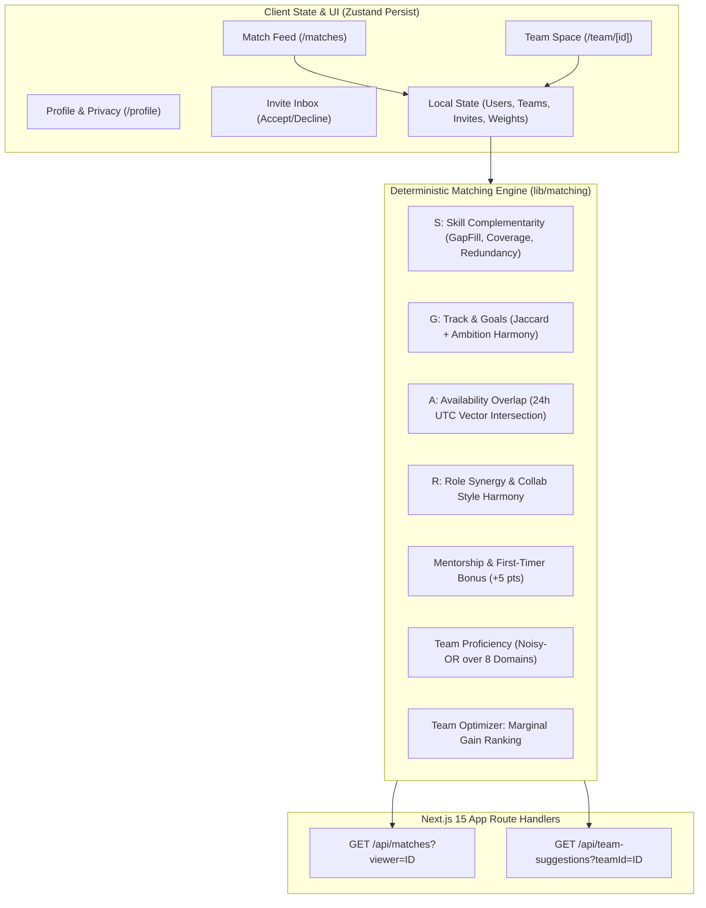

# SkillSync (Team Nexus) — Innovate India 2026

> **"Build a stronger hackathon team before the first line of code."**

SkillSync is an opt-in talent graph with an **explainable compatibility engine** that rewards complementary skill coverage over popularity, and an interactive Team Space that identifies capability gaps before building begins.

---

## The Problem

Hackathon participants traditionally form teams by chance or social popularity:
1. **Skill Duplication (The "Popular Trap"):** Teams frequently end up with three 10x React frontend developers and zero AI or backend engineers.
2. **Missing Critical Capabilities:** Projects stall at 3:00 AM because nobody can configure API routes, deploy models, or design accessible UI.
3. **Mismatched Work Styles & Timezones:** Friction between async documenters vs. continuous voice-call hackers, or teammates with zero overlapping working hours.
4. **No Entry Route for Beginners:** High-potential first-timers get excluded due to lack of star ratings, despite high energy and willingness to learn.

---

## The Solution

SkillSync flips the paradigm from **popularity-matching** to **complementary capability assembly**:
- **Explainable by Design:** Every score displays its transparent factor breakdown, point contributions, and evidence bullets. No black-box AI verdicts.
- **Complementarity Over Popularity:** Redundancy is penalized; filling a team gap is rewarded.
- **Team Space Radar & Gap Detection:** Live 8-domain coverage radar powered by probabilistic noisy-OR, highlighting vulnerabilities before code is written.
- **Mentorship & Growth Incentives:** Veteran builders pairing with eager first-timers earn an explicit mentorship bonus (+5 pts).
- **Privacy First:** Opt-in, no sensitive attributes (gender, age, college, location are excluded), one-click data deletion.

---

## System Architecture



---

## Mathematical Scoring Engine

Total compatibility score between viewer $u$ (or team $T$) and candidate $c$:

$$\text{Total} = \min\left(100, \left\lfloor 100 \times \left(w_S S + w_G G + w_A A + w_R R\right) + \text{Bonus} \right\rfloor\right)$$

Where default weights are $w_S = 0.40, w_G = 0.25, w_A = 0.20, w_R = 0.15$ (interactive sliders auto-normalize to $\sum w = 1.0$).

### 1. Skill Complementarity ($S$)
Domain proficiency $p_u(d) = \frac{\max_{s \in d}(\text{confidence})}{5} \in [0, 1]$.
$$\text{GapFill} = \frac{\sum_d w_d \max(0, p_c(d) - p_u(d))}{\sum_d w_d (1 - p_u(d))}$$
$$\text{Coverage} = \frac{\sum_d w_d \max(p_u(d), p_c(d))}{\sum_d w_d}$$
$$\text{Redundancy} = \frac{\sum_d w_d \min(p_u(d), p_c(d))}{\sum_d w_d \max(p_u(d), p_c(d))}$$
$$S = \text{clamp}(0.50 \cdot \text{GapFill} + 0.30 \cdot \text{Coverage} + 0.20 \cdot (1 - \text{Redundancy}), 0, 1)$$

### 2. Goals & Track Alignment ($G$)
$$G = 0.50 \cdot \text{Jaccard}(\text{tracks}_u, \text{tracks}_c) + 0.30 \cdot \text{Jaccard}(\text{goals}_u, \text{goals}_c) + 0.20 \cdot \left(1 - \frac{|\text{ambition}_u - \text{ambition}_c|}{4}\right)$$

### 3. Availability Overlap ($A$)
$$\text{overlapHours} = \sum_{h=0}^{23} (\text{hoursUtc}_u[h] \land \text{hoursUtc}_c[h])$$
$$A = \min\left(1, \frac{\text{overlapHours}}{4}\right) \quad (\text{Caution flagged if } \text{overlapHours} < 2)$$

### 4. Role Harmony & Collaboration ($R$)
- **Complementary Pairs** (Frontend–Backend, Frontend–UI/UX, Backend–AI/ML, AI/ML–UI/UX, PM–NonPM) $\to \text{RoleScore} = 1.0$.
- **Same Primary Role** $\to \text{RoleScore} = 0.2$.
- **Neutral** $\to \text{RoleScore} = 0.6$.
- $\text{Collab} = 1 - \frac{\text{paceDiff} + \text{structureDiff}}{2}$.
$$R = 0.65 \cdot \text{RoleScore} + 0.35 \cdot \text{Collab}$$

### 5. Team Space Coverage & Marginal Gain
- **Domain Coverage (Noisy-OR):**
$$p_T(d) = 1 - \prod_{m \in T} (1 - p_m(d))$$
- **Team Score:**
$$\text{TeamScore} = 100 \times \left(0.50 \cdot \text{weightedCoverage} + 0.20 \cdot (1 - \text{roleImbalance}) + 0.15 \cdot \text{avgPairwise} + 0.15 \cdot \min(1, \frac{\text{overlapAll}}{3})\right)$$
- **Suggestion Marginal Gain:**
$$\text{MarginalGain}(c) = \text{TeamScore}(T \cup \{c\}) - \text{TeamScore}(T)$$

---

## Safeguards

| Safeguard | Implementation in SkillSync |
|---|---|
| **Privacy First** | Opt-in talent graph. Single-click "Delete My Data" permanently purges client state. |
| **Zero Bias by Design** | Gender, age, college prestige, ethnic name, and geographic origin are **strictly excluded** from scoring. Only timezone offset is used for schedule overlap. |
| **False Precision Defense** | Scores are presented alongside verbal verdicts (Strong $\ge 75$, Good $\ge 50$, Fair $\ge 30$, Weak $< 30$) and explicit factor breakdowns. |
| **Cold Start & Beginners** | Dedicated +5 pts mentorship bonus for pairing first-timers/learners with experienced guides. |
| **Human Agency** | System **never assigns teams automatically**. Scores are guides, not verdicts. |

---

## Architecture Evolution

- **Round 1 Proposal:** React SPA + Express.js backend + MongoDB database.
- **Hackathon Prototype (Current):** Next.js 15 App Router, TypeScript strict, pure deterministic matching engine in `lib/matching/`, Zustand with localStorage persistence. Zero external databases or API keys required.
- **Production Path:** Supabase PostgreSQL with row-level security (RLS), Edge Functions for real-time WebSocket invite sync, and verifiable credential attestations for past hackathon project contributions.

---

## Decisions Made During Build

1. **Deterministic Explanations:** Used structured template strings and conditional logic rather than generative LLMs to guarantee instant, repeatable, verifiable explanations without latency, cost, or hallucinations.
2. **Local Time Block Mapping:** Converted 6 human-friendly time blocks (Morning, Midday, Afternoon, Evening, Night, Late) to standard 24-hour UTC vectors using the client's timezone offset, allowing seamless global timezone intersection.
3. **Noisy-OR Team Aggregation:** Chose probabilistic independent noisy-OR for domain coverage, which mathematically guarantees monotonicity: adding a new builder never lowers existing domain proficiency.
4. **Avatar Generation:** Standardized on Dicebear initial avatars (`https://api.dicebear.com/9.x/initials/svg?seed=NAME`) for deterministic, lightweight visual identification without external auth services.
5. **Scenario Hot-Swapping:** Implemented instant Scenario A/B switching in Navbar so judges can switch between a fresh solo builder state (Scenario A) and an active team gap state (Scenario B) in under 1 second.

---

## Key Pilot Metrics (Simulated on 20 Personas)

- **Skill Redundancy Reduction:** Redundant superstar pairings (e.g., Ananya ↔ Vikram Shah) penalized from 80+ to 52 pts due to duplicate frontend coverage.
- **Complementary Promotion:** Cross-functional complementary pairing (Ananya ↔ Rohan Mehta) ranks #1 with 77 pts and 6h overlap.
- **Team Gap Elimination:** Team Nexus AI/ML coverage increases from 0% to 80% upon adding Rohan Mehta, yielding a +9.65 marginal team gain.

---

## Quickstart & Verification

```bash
# Clone and navigate
cd skillsync-antigravity

# Install dependencies
npm install

# Run Vitest test suite (7/7 tests passing)
npm test

# Run Next.js production build (zero warnings/errors)
npm run build

# Start local dev server
npm run dev
```

Open [http://localhost:3000](http://localhost:3000) in your browser.

---

## 3-Minute Hackathon Demo Script for Judges

1. **0:00 - 0:40 (The Problem & Landing):**
   - Open `/`. Explain how hackathon teams fail due to 3 duplicate frontend devs and zero AI devs.
   - Click **"Try the Demo Feed"**.
2. **0:40 - 1:20 (The Popular Trap & Explainability):**
   - Point out **Rohan Mehta** (#1, 77 pts) vs. **Vikram Shah** (#16, 52 pts).
   - Click **"Why this match?"** on Rohan: explain the AI/ML gap fill (+3) and 6h IST overlap.
   - Click **"Why this match?"** on Vikram: note the amber caution ("High skill redundancy 100%").
   - Drag the **"Schedule Overlap"** slider to 60%: observe feed instantly re-sort live.
3. **1:20 - 2:00 (The Invite Flow):**
   - Click **"Invite"** on Rohan Mehta and send a note.
   - Switch persona to **Rohan Mehta** using the navbar switcher.
   - Open the **Invite Inbox** bell: see Ananya's pending invite.
   - Click **"Accept"**: toast confirms "Team Nexus formed".
4. **2:00 - 2:40 (Team Space & What-If Preview):**
   - Switch back to Ananya and navigate to **My Team**.
   - Inspect the **CoverageRadar**: observe AI/ML coverage jumped from 0% to 80%.
   - In **AI Team Optimizer Suggestions**, hover over remaining candidates to see live green dashed "what-if" radar overlay preview!
5. **2:40 - 3:00 (Privacy & Reset):**
   - Visit `/profile`: demonstrate 6 time block toggles and "Delete My Data" button.
   - Click **"Scen A"** in navbar: full demo state resets in under 1 second.


## New: Dream Team Assembler
`lib/matching/dreamTeam.ts` searches all teams around a viewer (drawn from discoverable, unteamed participants) and ranks them by the same whole-team score used in Team Space. It also reports the lift over the naive "invite your top individual matches" team. Exposed via `GET /api/dream-team?viewer=ID&size=4` and the **Dream Team Assembler** panel on `/matches`. See `DEMO.md` for the 3-minute pitch script.


## Idea Brief ↔ Prototype traceability
| Brief promise | Where it lives |
|---|---|
| Profile: skills, confidence, role, goals, availability, collaboration | `/profile`, `lib/types.ts` |
| Explainable matches (S, G, A, R + mentorship bonus) | `/matches`, `lib/matching/explain.ts` |
| Mutual fit | `computeMutualScore` in `lib/matching/audit.ts` |
| Recommend people **and small teams** | Dream Team Assembler, `lib/matching/dreamTeam.ts` |
| Team-level capability gaps | `/team/[id]`, `lib/matching/team.ts` |
| Agree on roles and a first milestone | Kickoff Plan, `lib/matching/kickoff.ts` |
| Organizers define participation rules | `/organizer` → Max team size |
| Pilot metrics (invite rate, role coverage, first-timers, opt-outs) | `/organizer` |
| Bias: audit exposure across participants | Exposure audit, `computeExposureAudit` |
| Cold start: organizer-led introductions | `suggestIntroductions` |
| Privacy: hide/delete profile | `/profile` |
